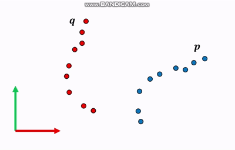

_그림1. 적절한 R과 T를 통해 두 데이터를 정렬_

두 데이터셋이 비슷하게 생겼다면 누구든 두 데이터셋을 한번 겹쳐보고 싶을것이다.

그러면 한 데이터셋 기준으로 다른 하나를 회전시키고 이동시킨다면 될것인데

문제는 "어떻게 회전 및 이동"을 할거냐는 것이다.

해당 포스터에서 이를 해결하기 위한 Kabsch 알고리즘을 소개하고자 한다.

kabsch알고리즘은 3차원 상 두 데이터의 거리제곱오차를 최소화하는 R과 T를 구하는 알고리즘이다.

먼저, "두 데이터셋이 정렬되었다"를 수학적으로 표현할 필요가 있다.

$$
E\left(R,T\right)=\sum _{i=1}^N\|q_i - (Rp_i + T)\|^2
$$

여기서 q와 p는 각각 3xN의 데이터셋이다. 이제 해당 오차를 최소화하는 R과 T를 구해볼것이다.

먼저, 각 데이터에 대한 무게 중심을 정의해보자.

$$
\overline {p}=\frac{\sum _{i=1}^Np_i}{N},\ \ \ \ \ \ \overline {q}=\frac{\sum _{i=1}^Nq_i}{N}
$$

그 다음, 각 데이터셋에 무게중심을 뺀 값을 다시 정의하여 영평균화를 진행한다

$$
x_i=p_i-\overline {p},\ \ y_i=q_i-\overline {q}
$$
$$
i\ \in \ \left[1,N\right]
$$

그 다음 비용함수에 이를 대입하고 정리해본다

$$
E\left(R,T\right)=\sum _{i=1}^N\left|\left|\mathbf{y_i+\overline {q}-\left(R\left(x_i+\overline {p}\right)+T\right)}\right|\right|^2
$$
$$
=\sum _{i=1}^N\left|\left|\mathbf{y_i-Rx_i+\underbrace{\left(\overline{q}-R\overline{p}-T\right)}_{\triangleq T'}}\right|\right|^2
$$
$$
E\left(R,T''\right)=\sum _{i=1}^N\|y_i - Rx_i + T'\|^2
$$

여기서 x_i와 y_i, T'이 3x1벡터임을 이용할것이다.

벡터 노름의 제곱 성질은 다음과 같다

$$
\left|\left|\mathbf{v+u}\right|\right|^2=\left|\left|\mathbf{v}\right|\right|^2+\left|\left|u\right|\right|^2+2v^Tu
$$

이를 이용해 식을 정리해준다

$$
E\left(R,T''\right)=\sum _{i=1}^N\|(y_i - Rx_i) + T'\|^2
$$
$$
=\sum _{i=1}^N\left(\|y_i - Rx_i\|^2+\|T'\|^2+\left(T''\right)^T\left(y_i-Rx_i\right)\right)
$$
$$
=\sum _{i=1}^N\|y_i - Rx_i\|^2+N\|T'\|^2+\left(T''\right)^T\left(\sum _{i=1}^Ny_i-R\sum _{i=1}^Nx_i\right)
$$
$$
=\sum _{i=1}^N\|y_i - Rx_i\|^2+N\|T'\|^2
$$

xi와 yi는 영평균화된 데이터이다. 즉, 각 데이터를 다 합치면 0이 나온다는것을 참고하자.

이제 첫째항은 R에 대한 항, 둘째 항은 T'에 대한 항이다. 두 항 다 0보다 크고 R과 T'는 독립적이기 때문에 각 항이 최소가 되면 되겠다.

먼저, T'은 0이될 수 있다. 이로부터 T를 구해보자.

$$
T''=\overline {q}-R\overline {p}-T=0
$$
$$
\therefore T=\overline {q}-R\overline {p}
$$

이제 R만 구하면 문제는 해결된다.

이제 다시 벡터 노름의 제곱 성질을 활용한다.

$$
E\left(R\right)=\sum _{i=1}^N\|y_i - Rx_i\|^2
$$
$$
=\left(\sum _{i=1}^N\|y_i\|^2+\sum _{i=1}^N\|x_i\|^2\right)-2\sum _{i=1}^N\left(y_i\right)^TRx_i
$$

앞에 괄호친 부분은 R과 무관하다. 편의를 위해 새로운 문제로 재정의 해보겠다.

$$
R_{opt}=\arg \max _R\mathbf{\sum _{i=1}^N\left(y_i\right)^TRx_i}
$$

이전 비용 함수에서 뒤의 항에 음수를 제거함으로서 최소화에서 최대화 문제로 변경되었음을 참고하자.

이어서 진행하기 이전에, 행렬 대각합의 교환법칙에 대해 짚고 넘어가자.( 증명은 생략 )

$$
Tr\left(AB\right)=Tr\left(BA\right)
$$

어떤 행렬곱의 결과가 스칼라값이면 이는 대각합과 같다(스칼라는 1x1행렬이기도 하니까)

이를 이용해서 이렇게 정리해본다.

$$
\mathbf{\sum _{i=1}^N\left(y_i\right)^TRx_i}=\sum _{i=1}^NTr\left(\left(y_i\right)^TRx_i\right)=\sum _{i=1}^NTr\left(Rx_i\left(y_i\right)^T\right)=Tr\left(R\sum _{i=1}^Nx_i\left(y_i\right)^T\right)
$$

특히 두번째항에서 세번째항으로 넘어갈 떄 1x1행렬에서 3x3행렬로 변경됨에 주의하자.

마지막 항에 xi와 yi의 상호 공분산 행렬이 존재한다.

$$
H=\sum _{i=1}^Nx_i\left(y_i\right)^T
$$
$$
Tr\left(R\sum _{i=1}^Nx_i\left(y_i\right)^T\right)=Tr\left(RH\right)
$$

H를 특이값 분해를 진행하고, 각 행렬의 특징을 정리해보자

$$
H=USV^T
$$
$$
UU^T=U^TU=VV^T=V^TV=I\ :\ U,V\text{는직교행렬}
$$
$$
S=diag\left(\sigma _1,\sigma _2,\sigma _3\right)\ :\ \text{특이값}\ \text{대각행렬},\ \sigma \gt 0
$$

이제 거의 마지막이다. 해당 결과를 대입하여 정리한다.

Z는 직교행렬들의 곱이므로 이또한 직교행렬임을 참고하자.

$$
Tr\left(RH\right)=Tr\left(RUSV^T\right)=Tr\left(SV^TRU\right)
$$
$$
=Tr\left(SZ\right)
$$
$$
=\sigma _1z_{11}+\sigma _2z_{22}+\sigma _3z_{33}
$$
$$
Z\text{가}\ I\text{일때}\ Tr\left(RH\right)\text{는최대가}\ \text{된다}
$$
$$
\therefore R=VU^T
$$

다시 식으로 결과를 정리하면 다음과 같다.

$$
\therefore T=\overline {q}-R\overline {p},\ \ R=VU^T
$$
$$
H=\sum _{i=1}^Nx_i\left(y_i\right)^T,\ \ H=USV^T
$$

이로서 두 데이터셋의 거리 제곱이 최소가 되도록 하는 R,T를 도출하였다.

### 반사(Reflection) 방지 조건

회전 행렬 $R$은 순수 회전이어야 하므로 $\det(R) = +1$을 만족해야 한다.

만약 특이값 분해 결과로 계산된 $\det(VU^T) = -1$이라면, 이는 회전이 아닌 거울 반사(Reflection)가 포함된 상태다.

따라서 Kabsch 알고리즘에서는 부호 $d = \det(VU^T)$를 반영하여 다음과 같이 안전하게 보정한다:

$$
R = V \begin{pmatrix} 1 & 0 & 0 \\ 0 & 1 & 0 \\ 0 & 0 & d \end{pmatrix} U^T
$$
