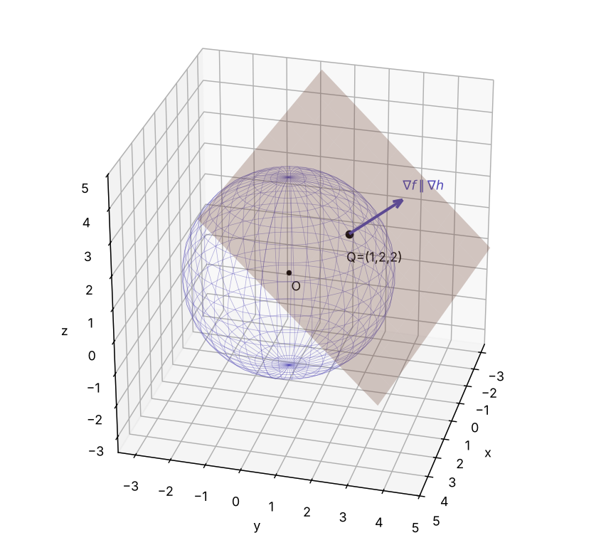
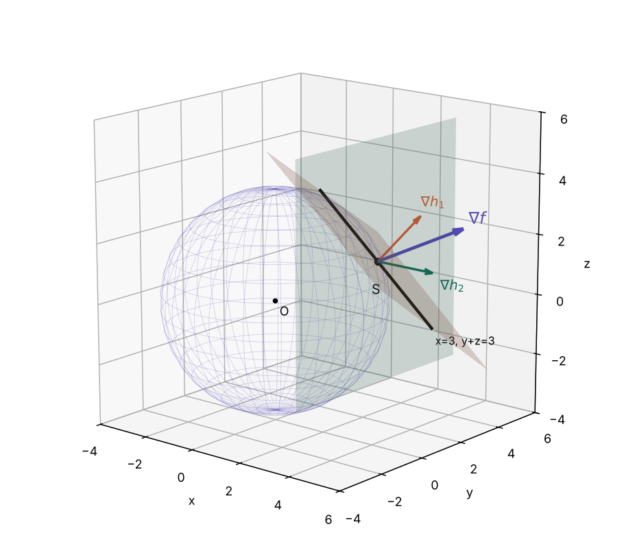
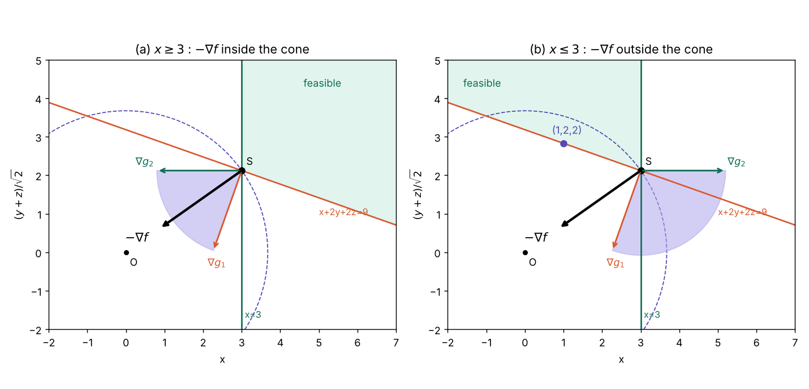

제약 조건이 있는 최적화 문제를 푸는 방법이다.

현실의 최적화 문제에는 대부분 조건이 붙는다. 예산이 정해져 있다거나, 어떤 값이 일정 수준 아래로 떨어지면 안 된다거나 하는 식이다.

공식 자체는 간단하지만 왜 그런 식이 나오는지는 잘 와닿지 않는다. 그래서 이번 글에서는 예제 하나를 끝까지 들고 가면서 하나씩 따라가보려 한다.

---

## 0. 일반형

### 문제

$$
\begin{aligned}
\min_{x \in \mathbb{R}^n} \quad & f(x) \\
\text{s.t.} \quad & h_i(x) = 0, \quad i = 1, \dots, m \quad (\text{등식 제약}) \\
& g_j(x) \le 0, \quad j = 1, \dots, p \quad (\text{부등식 제약})
\end{aligned}
$$

### 라그랑지안

제약마다 승수를 하나씩 붙여서 목적함수에 더해준다.

$$
\mathcal{L}(x, \lambda, \mu) = f(x) + \sum_{i=1}^{m} \lambda_i h_i(x) + \sum_{j=1}^{p} \mu_j g_j(x)
$$

### KKT 조건

최적점 $x^*$는 다음 네 가지를 만족해야 한다.

$$
\begin{aligned}
&\text{① 정상성:} && \nabla f(x^*) + \sum_i \lambda_i \nabla h_i(x^*) + \sum_j \mu_j \nabla g_j(x^*) = 0 \\
&\text{② 원 실현가능성:} && h_i(x^*) = 0, \quad g_j(x^*) \le 0 \\
&\text{③ 쌍대 실현가능성:} && \mu_j \ge 0 \\
&\text{④ 상보 여유성:} && \mu_j \, g_j(x^*) = 0
\end{aligned}
$$

( 교재에 따라 $f - \lambda h$로 쓰기도 한다. 여기서는 최소화 문제에 $+$를 붙이는 표기로 통일한다. 부호만 다르고 의미는 같다. )

단어들이 어려워 보이지만 개념을 보면 당연한 말들이다.

---

## 1. 그라디언트

그라디언트는 편미분을 모아놓은 벡터다.

$$
\nabla f(x) = \left( \frac{\partial f}{\partial x_1}, \dots, \frac{\partial f}{\partial x_n} \right)
$$

보통 "함수가 증가하는 방향"이라고 하는데, 정확히는 가장 가파르게 증가하는 방향이다.

인수 $x$를 단위벡터 $u$ 방향으로 아주 조금 움직였을 때 $f$의 변화율은 다음과 같다.

$$
D_u f = \nabla f \cdot u = \|\nabla f\| \cos\theta
$$

즉, $u$와 그라디언트 사이의 각도에 따라 변화율이 정해진다.

같은 방향($\theta = 0$)이면 가장 가파른 오르막이고,
반대 방향($\theta = 180^\circ$)이면 가장 가파른 내리막이다. 경사하강법이 $-\nabla f$로 가는 이유다.
수직($\theta = 90^\circ$)이면 변화율이 0, 즉 함숫값이 변하지 않는다.

---

## 2. 예제: 원점에서 가장 가까운 점

이번 글에서는 다음 함수 하나만 쓴다.

$$
f(x, y, z) = x^2 + y^2 + z^2, \qquad \nabla f = 2(x, y, z)
$$

원점으로부터 거리의 제곱이다.

$f$가 같은 점들을 이으면 원점을 중심으로 하는 구면이 되고, $\nabla f$는 원점에서 바깥쪽을 가리킨다.

---

## 3. 등식 제약

### 3.1 평면 하나

$$
\min\ f \quad \text{s.t.} \quad h_1 = x + 2y + 2z - 9 = 0
$$

점은 제약 조건을 만족해야 하기 때문에 이 평면 위에서만 움직일 수 있다. 평면의 그라디언트 $\nabla h_1 = (1, 2, 2)$는 평면의 법선 벡터다.

일단 평면 위의 아무 점 $P = (9, 0, 0)$을 잡아보자.

$$
\nabla f(P) = (18, 0, 0), \qquad \nabla h_1 = (1, 2, 2)
$$

두 벡터가 가리키는 방향이 다르다.

두 벡터가 같은 방향을 가리키지 않는다면, 제약 조건을 지키면서도 $f$를 개선하는 방향으로 움직일 수 있다.

왜 그런지 $\nabla f$를 두 성분으로 쪼개서 보자.

$$
\nabla f = \underbrace{\frac{\nabla f \cdot \nabla h_1}{\|\nabla h_1\|^2} \nabla h_1}_{\text{평면에 수직인 성분}} + \underbrace{\nabla f_T}_{\text{평면을 따라가는 성분}}
$$

$P$에서 실제로 계산하면 다음과 같다.

$$
(18, 0, 0) = \underbrace{(2, 4, 4)}_{\text{수직}} + \underbrace{(16, -4, -4)}_{\text{평면 방향}}
$$

평면에 수직인 성분은 쓸 수 없다. 그쪽으로 가면 평면을 벗어나기 때문이다.

반면 평면 방향 성분은 평면 위에서 움직이면서도 $f$를 바꿀 수 있다.

이 성분이 0이 아니니까, 반대 방향 $-(16, -4, -4)$로 평면을 따라 이동하면 $f$가 줄어든다.

이동한 점에서는 $\nabla f$도 바뀌므로, 다시 평면 방향 성분을 구해 그 반대쪽으로 조금씩 이동한다. 이를 반복하다가 $\nabla f$와 $\nabla h_1$이 같은 방향이 되면 평면 방향 성분이 사라진다. 더 이상 갈 곳이 없으니 거기가 최적점이다.

그 점은 정상성 조건 $\nabla f + \lambda_1 \nabla h_1 = 0$과 제약식을 연립하면 구할 수 있다.

$$
\begin{aligned}
2x + \lambda_1 &= 0 \\
2y + 2\lambda_1 &= 0 \\
2z + 2\lambda_1 &= 0 \\
x + 2y + 2z &= 9
\end{aligned}
$$

위의 세 식에서 $x = -\lambda_1 / 2$, $y = z = -\lambda_1$이고, 이를 마지막 제약식에 대입하면 $-\frac{9}{2}\lambda_1 = 9$, 즉 $\lambda_1 = -2$다. 따라서 최적점은 $Q = (1, 2, 2)$다.

실제로 $Q$에서 두 벡터를 확인해보면 같은 방향을 가리킨다.

$$
\nabla f(Q) = (2, 4, 4) = 2 \, (1, 2, 2) = 2 \, \nabla h_1
$$

Fig.1 반지름 3인 구가 평면 x+2y+2z=9에 Q=(1,2,2)에서 접한다. 접점에서 ∇f와 평면 법선이 같은 방향이다

이 식이 말하는 바는 다음과 같다: 최적점에서는 $\nabla f$에 평면 방향 성분이 남아 있지 않다. 즉, $\nabla f$와 $\nabla h$가 평행하다.

그림으로 보면 반지름 3인 구가 평면에 딱 닿는 순간이다. 이때 구의 법선($\nabla f$)과 평면의 법선($\nabla h_1$)이 같은 방향을 가리킨다.

( 승수 $\lambda$도 별다른 게 아니라, $\nabla f$를 $\nabla h$ 방향으로 사영했을 때의 계수에 부호를 바꾼 값이다. )

### 3.2 평면 두 개

제약을 하나 더 넣어보자.

$$
h_1 = x + 2y + 2z - 9 = 0, \qquad h_2 = x - 3 = 0
$$

두 평면이 만나면 직선이 된다. $x = 3$, $y + z = 3$인 직선이고, 움직일 수 있는 방향은 $\pm(0, 1, -1)$ 하나뿐이다.

이 방향은 $\nabla h_1 = (1, 2, 2)$, $\nabla h_2 = (1, 0, 0)$ 둘 다와 수직이다.

일반적으로 움직일 수 있는 방향은 모든 제약 그라디언트에 수직인 방향이다.

$$
T = \{ d \mid \nabla h_i \cdot d = 0, \ \ \forall i \}
$$

이를 접공간(tangent space)이라 부른다. 3.1에서는 평면이었고, 지금은 직선이다.

쪼개는 방식은 3.1과 똑같다. "$\nabla h_1$ 방향 성분"이 "$\nabla h_1$, $\nabla h_2$가 펼치는 공간의 성분"으로 바뀔 뿐이다.

$$
\nabla f = \underbrace{\left(\text{span}\{\nabla h_1, \nabla h_2\} \text{ 성분}\right)}_{\text{쓸 수 없음}} + \underbrace{\nabla f_T}_{T \text{ 성분}}
$$

직선 위의 점 $R = (3, 3, 0)$에서는 $\nabla f = (6, 6, 0)$이다. 직선 방향 $(0, 1, -1)$과 내적하면 6이 나온다. 직선 방향 성분이 남아 있으니 아직 더 갈 수 있다.

$S = (3, 1.5, 1.5)$에서는 $\nabla f = (6, 3, 3)$이고, 직선 방향과 내적하면 0이다. 여기가 최적점이다.

이때 $\nabla f$는 두 법선의 선형결합으로 표현된다.

$$
(6, 3, 3) + \lambda_1 (1, 2, 2) + \lambda_2 (1, 0, 0) = 0 \ \Rightarrow\ \lambda_1 = -1.5,\ \lambda_2 = -4.5
$$

( $S$와 승수들 역시 3.1처럼 정상성 조건과 두 제약식을 연립하면 바로 구해진다. )

Fig.2 두 평면 x+2y+2z=9, x=3이 만나는 직선에 구가 S=(3,1.5,1.5)에서 접한다. ∇f는 ∇h1과 ∇h2 사이, 즉 두 법선이 펼치는 평면 안에 있다

즉, 최적점에서 $\nabla f$는 제약 그라디언트들이 펼치는 공간 안에 들어가 있어야 한다.

3.1의 "평행"은 제약이 하나일 때의 특수한 경우였던 것이다. 제약이 하나면 그 공간이 직선 하나니까.

참고로 미지수와 방정식 개수도 딱 맞는다. 미지수는 $x$ $n$개와 $\lambda$ $m$개, 방정식은 정상성 $n$개와 제약 $m$개다. 그래서 라그랑지안을 $(x, \lambda)$로 미분해서 0으로 두는 것만으로 문제가 풀린다.

$$
\nabla_x \mathcal{L} = 0, \qquad \nabla_\lambda \mathcal{L} = h(x) = 0
$$

( 단, 최적점에서 $\nabla h_i$들이 선형독립이어야 이 논리가 성립한다. 대부분 만족하지만, 증명에서는 꼭 깔려 있는 가정이다. )

---

## 4. 부등식 제약

이번에는 3.1의 평면을 부등식으로 바꿔본다.

부등식 제약은 한쪽만 막혀 있고, 경계에 닿았을 때만 의미가 있는 반쪽짜리 제약이다.

같은 평면이라도 어느 쪽을 허용하느냐에 따라 결과가 완전히 달라진다.

### 4.1 원점이 영역 밖에 있는 경우

$$
g_1 = 9 - (x + 2y + 2z) \le 0 \quad (\text{즉 } x + 2y + 2z \ge 9)
$$

원점이 영역 밖에 있으므로 최적점은 경계 평면 위에 있고, 3.1과 같은 $Q = (1, 2, 2)$다.

$\nabla g_1 = -(1, 2, 2)$는 $g_1$이 커지는 쪽, 즉 제약을 어기는 쪽(원점 쪽)을 가리킨다.

$$
\nabla f(Q) + \mu_1 \nabla g_1 = (2, 4, 4) - \mu_1 (1, 2, 2) = 0 \ \Rightarrow\ \mu_1 = 2 \ge 0
$$

$f$를 줄이고 싶은 방향 $-\nabla f = (-2, -4, -4)$는 원점 쪽, 그러니까 경계 너머를 향한다. 가고 싶은 곳이 전부 경계 너머이니 여기서 멈출 수밖에 없다.

### 4.2 원점이 영역 안에 있는 경우

$$
g_1 = (x + 2y + 2z) - 9 \le 0 \quad (\text{즉 } x + 2y + 2z \le 9)
$$

$f$의 최솟값은 $(x, y, z)$가 원점일 때이고, 현재 제약 조건 영역에 원점이 포함되니 원점이 최적점이 된다. 경계에 닿지 않으므로 $\mu_1 = 0$이고, 정상성은 그냥 $\nabla f = 0$이 된다.

그러면 이 문제에서 경계 위의 점 $Q = (1, 2, 2)$를 KKT로 검사하면 어떻게 될까?

$$
(2, 4, 4) + \mu_1 (1, 2, 2) = 0 \ \Rightarrow\ \mu_1 = -2 < 0
$$

음수가 나온다. 이번에는 $-\nabla f = (-2, -4, -4)$가 영역 안쪽을 향한다.

헷갈리기 쉬운 부분인데, "안쪽으로 가기만 하면 $f$가 줄어든다"는 뜻은 아니다. 안쪽 방향 중에도 $f$가 커지는 방향은 얼마든지 있다.

최적점이 아니라는 걸 보이려면 제약을 지키면서 $f$가 줄어드는 방향이 있으면 된다. 그리고 지금은 $d = -\nabla f$ 자신이 그런 방향이다.

$\nabla f \cdot d = -\|\nabla f\|^2 < 0$이니 $f$가 줄어들고,
$\nabla g_1 \cdot d = \mu_1 \|\nabla g_1\|^2 < 0$이니 $g_1$도 줄어들어 영역 안쪽으로 들어간다.

그래서 $\mu \ge 0$이어야 한다. 이게 ③ 쌍대 실현가능성이다.

( 등식 제약은 양쪽이 다 막혀 있으니 이런 문제가 없다. 3장의 $\lambda$가 음수여도 상관없었던 이유다. )

### 4.3 상보 여유성

$$
\mu_j \, g_j(x^*) = 0
$$

곱해진 두 항 중 적어도 하나는 0이라는 뜻이다. 둘 다 0일 수도 있다.

4.1의 평면을 $x + 2y + 2z \ge c$로 바꿔서 $c$를 움직여보면 세 경우가 다 나온다.

| $c$ | 원점의 위치 | $x^*$ | $g_1(x^*)$ | $\mu_1$ |
|---|---|---|---|---|
| 9 | 영역 밖 | $(1, 2, 2)$ | 0 (경계 위) | 2 |
| 0 | 경계 위 | 원점 | 0 (경계 위) | 0 |
| $-9$ | 영역 안 | 원점 | $-9$ (경계에서 떨어짐) | 0 |

경계에서 떨어져 있으면 $\mu = 0$이다. 정상성 식에서 그 제약이 아예 빠진다는 뜻이다.

$c = 0$은 원점이 우연히 경계 위에 있을 뿐, 경계가 없어도 어차피 거기서 멈추는 경우다. 그래서 둘 다 0이다.

### 4.4 정리

결국 ②③④는 "부등식은 반쪽짜리"라는 말을 수식으로 쓴 것이다.

| 반쪽짜리의 성질 | 조건 | 이름 |
|---|---|---|
| 한쪽 영역에만 있을 수 있다 | $g(x^*) \le 0$ | 원 실현가능성 |
| 한쪽 방향으로만 막는다 | $\mu \ge 0$ | 쌍대 실현가능성 |
| 닿았을 때만 작동한다 | $\mu \, g(x^*) = 0$ | 상보 여유성 |

실제로 최적점을 정하는 건 ① 정상성이고, 나머지는 반쪽짜리 제약을 제대로 다루기 위한 조건이라 볼 수 있겠다.

---

## 5. 부채꼴(법선 원뿔)

이번에는 3.2의 두 평면을 둘 다 부등식으로 바꿔보자.

$$
g_1 = 9 - (x + 2y + 2z) \le 0, \qquad g_2 = 3 - x \le 0
$$

평면 하나만 있을 때의 답 $(1, 2, 2)$는 $x \ge 3$을 어기고, $x \ge 3$만 있을 때의 답 $(3, 0, 0)$은 첫 번째 제약을 어긴다. 그러니 답은 두 경계가 만나는 모서리 위에 있을 것이고, 3.2와 같은 $S = (3, 1.5, 1.5)$가 된다.

이 모서리에서는 "제약을 어기는 방향"이 하나가 아니다. $\nabla g_1 = -(1, 2, 2)$와 $\nabla g_2 = (-1, 0, 0)$ 사이의 부채꼴 전체가 다 그렇다.

$$
N(S) = \{\mu_1 \nabla g_1 + \mu_2 \nabla g_2 \mid \mu_1, \mu_2 \ge 0\}
$$

등식일 때는 $\lambda$ 부호가 자유라 두 법선이 펼치는 평면 전체였는데, 부등식은 $\mu \ge 0$이라 그 평면에서 부채꼴만 남은 것이다.

$S$에서 $-\nabla f = (-6, -3, -3)$을 이 부채꼴로 표현해보면 다음과 같다.

$$
(-6, -3, -3) = \mu_1 (-1, -2, -2) + \mu_2 (-1, 0, 0) \ \Rightarrow\ \mu_1 = 1.5,\ \mu_2 = 4.5
$$

둘 다 0 이상이다. $-\nabla f$가 부채꼴 안에 있다는 뜻이다.

반대로 두 번째 제약을 $x \le 3$으로 뒤집으면($\nabla g_2 = (1, 0, 0)$) 같은 점에서 $\mu_2 = -4.5$가 나온다. $-\nabla f$가 부채꼴 밖으로 나간 것이다. 실제로 이 경우의 답은 $(1, 2, 2)$로, $S$보다 원점에 더 가깝다.

Fig.3 직선 x=3, y+z=3 방향에서 바라본 단면. 보라색 부채꼴이 ∇g1, ∇g2로 만든 법선 원뿔이다. (a) -∇f가 부채꼴 안: 최적점 (b) 제약을 x≤3으로 뒤집으면 -∇f가 부채꼴 밖: 최적점 아님

부채꼴 밖으로 삐져나온 만큼의 성분이 곧 움직일 수 있는 방향이다.

반대로 $-\nabla f$가 부채꼴 안에 들어오면, 제약을 지키면서 $f$를 줄일 수 있는 방향이 하나도 남지 않는다.

> 즉, $-\nabla f$가 부채꼴 안에 들어온 순간 더 이상 움직일 수 없는 상태가 되고, 그 점이 최적점이다.

( 최대화 문제라면 $\nabla f$ 자체가 부채꼴 안에 들어오는지 보면 된다. )

### 5.1 일반화

이걸 높은 차원으로 확장하면, 한 점에서 활성 제약들의 그라디언트로 만든 벡터 영역이 생긴다.

$$
N(x^*) = \left\{ \sum_{i=1}^{m} \lambda_i \nabla h_i(x^*) + \sum_{j \in \mathcal{A}(x^*)} \mu_j \nabla g_j(x^*) \ \middle|\ \lambda_i \in \mathbb{R},\ \mu_j \ge 0 \right\}
$$

( $\mathcal{A}(x^*)$는 경계에 닿아 있는, 즉 $g_j(x^*) = 0$인 제약들의 집합이다. )

등식 제약 쪽은 $\lambda$ 부호가 자유라 평면 같은 부분공간이 되고, 부등식 쪽은 $\mu \ge 0$이라 부채꼴이 된다.

이 영역을 법선 원뿔(normal cone)이라 부른다. 그러면 KKT 조건 전체를 한 줄로 쓸 수 있다.

$$
-\nabla f(x^*) \in N(x^*)
$$

이 식이 말하는 바는 다음과 같다: 최적점에서는 $f$를 줄이려는 방향이 활성 제약 그라디언트들로 만든 영역 안에 들어가 있다.

같은 평면이라도 등식이냐 부등식이냐, 어느 쪽을 허용하느냐에 따라 영역 모양(평면 / 부채꼴 / 없음)이 달라진다. 그에 따라 같은 $\nabla f$가 최적이 되기도 하고 아니기도 하다.

( 이건 필요조건이다. 최솟값이 아니라 최댓값이나 안장점에서도 성립할 수 있다. 다만 이번 예제처럼 $f$, $g_j$가 볼록이고 $h_i$가 선형이면 KKT를 만족하는 점이 곧 전역 최솟값이다. )

---

## 6. 승수의 크기

지금까지는 승수의 부호를 봤다. 그럼 크기는 무슨 의미일까?

4.3의 평면 $x + 2y + 2z \ge c$에서 $c > 0$이면 접점은 $\frac{c}{9}(1, 2, 2)$이고, 최솟값과 승수는 다음과 같다.

$$
f^*(c) = \frac{c^2}{9}, \qquad \mu_1 = \frac{2c}{9}
$$

$f^*$를 $c$로 미분하면 승수와 똑같은 값이 나온다.

$$
\frac{df^*}{dc} = \frac{2c}{9} = \mu_1
$$

$c = 9$에서 $\mu_1 = 2$다. 평면을 원점 쪽으로 $\epsilon$만큼 당겨주면, 그러니까 제약을 $\epsilon$만큼 풀어주면 최솟값이 약 $2\epsilon$ 줄어든다.

$$
f^*(9 - \epsilon) = \frac{(9 - \epsilon)^2}{9} = 9 - 2\epsilon + \frac{\epsilon^2}{9}
$$

일반적으로는 이렇게 쓴다. 제약을 $g_j(x) \le u_j$, $h_i(x) = v_i$로 살짝 옮긴 문제의 최적값을 $p^*(u, v)$라 하면 다음이 성립한다.

$$
\frac{\partial p^*}{\partial u_j} = -\mu_j, \qquad \frac{\partial p^*}{\partial v_i} = -\lambda_i
$$

즉, 승수는 제약을 아주 살짝 풀어줬을 때 최적값이 얼마나 좋아지는지를 나타낸다. 경제학에서는 이를 그림자 가격(shadow price)이라 부른다.

상보 여유성과도 잘 맞는다. 4.3의 $c = -9$처럼 닿지도 않은 제약은 $\mu = 0$인데, 그 제약을 풀어줘 봐야 얻는 게 없으니 당연하다.

등식 제약의 $\lambda$는 부호까지 의미가 있다. 3.1에서 $\lambda_1 = -2$였는데, 평면을 $x + 2y + 2z = 9 + v$로 옮기면 $\frac{\partial f^*}{\partial v} = 2$가 된다. 평면을 원점에서 멀리 옮기면 최솟값이 커진다는 뜻이다.

( 최적해가 제약 변화에 따라 매끈하게 움직이는 경우에 성립하는 1차 근사다. )

---

## 7. 정리

라그랑주 승수법을 한 문장으로 정리하면 다음과 같다.

"움직일 수 있는 방향으로는 더 이상 좋아질 수 없을 때 멈춰라"

등식 제약이면 $\nabla f$가 제약 그라디언트들이 펼치는 공간 안에 있어야 하고,
부등식 제약이면 그 공간이 부채꼴로 바뀐다. $\mu \ge 0$과 상보 여유성은 이걸 수식으로 쓴 것이다.
결국 $-\nabla f$가 부채꼴 안에 들어온 점이 최적점이고,
승수의 크기는 제약을 살짝 풀었을 때 얼마나 좋아지는지를 나타낸다.
