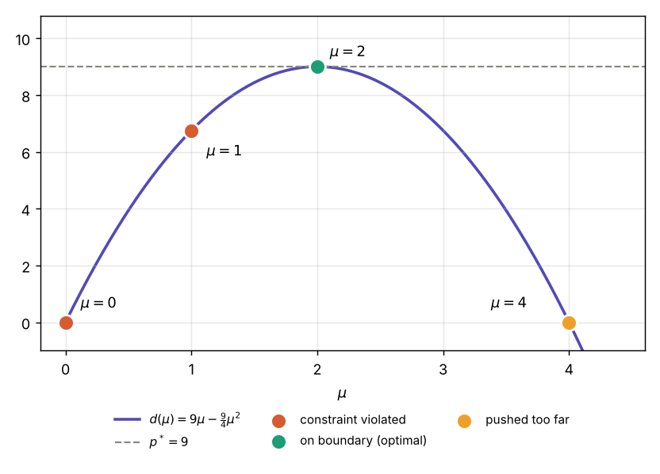
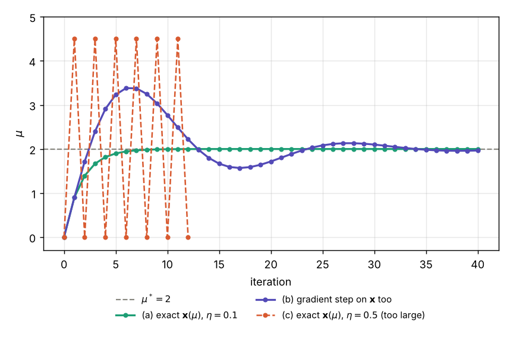

👉 사전 지식: [라그랑주 승수법(Lagrange Multiplier)과 KKT 조건](/posts/lagrange-multiplier/)

라그랑주 승수법 글에서는 승수를 "최적점에서 구해지는 값"으로 봤다.

이번 글에서는 반대로 승수를 변수로 놓고, 승수를 찾는 문제로 바꿔서 풀어본다. 이것이 쌍대 문제다.

결론부터 한 줄로 쓰면 다음과 같다.

> 제약 최적화는 min-max 문제이고, 쌍대성은 그것을 max-min 순서로 풀어도 같은 답이 나오는지를 다룬다. 같은 답이 나오면 인수 $x$ 대신 승수만 찾는 더 쉬운 문제로 바꿔 풀 수 있다.

---

## 0. 일반형

이 글은 최소화 문제를 기준으로 한다.

### 원 문제(primal)

$$
\begin{aligned}
p^* = \min_{x \in \mathbb{R}^n} \quad & f(x) \\
\text{s.t.} \quad & h_i(x) = 0, \quad i = 1, \dots, m \\
& g_j(x) \le 0, \quad j = 1, \dots, p
\end{aligned}
$$

$p^*$는 원 문제의 최적값이다. 제약을 지키면서 $f$가 가질 수 있는 가장 작은 값이고, p는 primal의 앞 글자다.

( 최적점 $x^*$와 헷갈리지 말자. $x^*$는 위치이고, $p^* = f(x^*)$는 그 위치에서의 함숫값이다. )

### 라그랑지안

$$
\mathcal{L}(x, \lambda, \mu) = f(x) + \sum_{i=1}^{m} \lambda_i h_i(x) + \sum_{j=1}^{p} \mu_j g_j(x), \qquad \mu_j \ge 0
$$

$\lambda_i$, $\mu_j$가 각 제약식에 곱해진 승수다.

### 쌍대 함수와 쌍대 문제(dual)

$$
d(\lambda, \mu) = \min_x\ \mathcal{L}(x, \lambda, \mu), \qquad d^* = \max_{\lambda,\ \mu \ge 0}\ d(\lambda, \mu)
$$

$d^*$는 쌍대 문제의 최적값이다. 그리고 둘 사이에는 다음 관계가 있다.

$$
d^* \le p^* \ \ (\text{약쌍대성, 항상 성립}), \qquad d^* = p^* \ \ (\text{강쌍대성, 조건부})
$$

---

## 1. 원 문제는 min-max다

제약 있는 원 문제는 라그랑지안으로 다음과 같이 다시 쓸 수 있다.

$$
p^* = \min_x \ \max_{\lambda,\ \mu \ge 0} \ \mathcal{L}(x, \lambda, \mu)
$$

$x$를 하나 고정하고, 승수 쪽에서 $\mathcal{L}$을 최대로 만든다고 생각해보자.

제약을 지키는 $x$라면 $\mu_j \ge 0$, $g_j(x) \le 0$이라 $\mu_j g_j(x) \le 0$이다. 그러니 $\mu = 0$이 최선이고, 이때 $\mathcal{L} = f$다.

제약을 어기는 $x$라면 승수를 키울수록 값이 계속 커진다. 그러니 바깥의 $\min_x$가 그런 $x$를 고를 일이 없다.

결국 "제약을 지키는 $x$ 중 $f$가 가장 작은 것"이라는 원 문제와 같아진다.

여기서 min과 max의 순서를 뒤집은 것이 쌍대 문제다.

$$
d^* = \max_{\lambda,\ \mu \ge 0} \ \min_x \ \mathcal{L}(x, \lambda, \mu)
$$

이제 순서를 뒤집은 문제를 직접 풀어보면서 둘이 어떤 관계인지 보자.

---

## 2. 예제: 쌍대 함수 구하기

라그랑주 승수법 글 4.1의 문제를 그대로 가져온다. 원점에서 가장 가까운 점을 찾는 문제다.

( 이 장부터는 점을 $\mathbf{x} = (x, y, z)$로 쓴다. )

$$
\min\ f(\mathbf{x}) = x^2 + y^2 + z^2 \quad \text{s.t.} \quad g = 9 - (x + 2y + 2z) \le 0
$$

답은 이미 알고 있다. 최적점은 $Q = (1, 2, 2)$, 승수는 $\mu = 2$, 최적값은 $p^* = f(Q) = 9$다.

라그랑지안은 다음과 같다.

$$
\mathcal{L}(\mathbf{x}, \mu) = x^2 + y^2 + z^2 + \mu\,(9 - x - 2y - 2z)
$$

승수 $\mu$를 고정하면 제약이 벌점 항으로 바뀐, 제약 없는 문제가 된다. 그러니 그냥 미분해서 0으로 두면 된다.

$$
2x - \mu = 0, \qquad 2y - 2\mu = 0, \qquad 2z - 2\mu = 0
$$

$\mu$를 문자로 둔 채로 풀었으니, $\mathbf{x}$가 $\mu$의 함수로 나온다.

$$
\mathbf{x}(\mu) = \left(\frac{\mu}{2},\ \mu,\ \mu\right) = \frac{\mu}{2}(1, 2, 2)
$$

이를 $\mathcal{L}$에 대입하면 $\mathbf{x}$가 사라지고 $\mu$만 남는다. 이것이 쌍대 함수다.

$$
d(\mu) = \frac{9}{4}\mu^2 + \mu\left(9 - \frac{9}{2}\mu\right) = 9\mu - \frac{9}{4}\mu^2
$$

3변수 제약 문제가 $\mu$ 하나짜리 함수로 바뀌었다.

---

## 3. 약쌍대성: 쌍대 함수는 항상 하한이다

$$
d(\lambda, \mu) \le p^* \qquad (\mu \ge 0 \text{인 모든 승수에 대해})
$$

증명은 간단하다. 제약을 지키는 아무 점 $x$에서 $h_i(x) = 0$이고, 1장에서 본 것처럼 $\mu_j g_j(x) \le 0$이다. 그래서 $\mathcal{L}(x) \le f(x)$가 된다.

$d$는 $\mathcal{L}$의 최솟값이니 $d \le \mathcal{L}(x) \le f(x)$이고, 이게 제약을 지키는 모든 $x$에서 성립하니 $d \le p^*$다.

( $\mu_j g_j(x) \le 0$은 제약을 지키는 점에서만 성립한다. 예제에서 $\mu = 2$일 때, 경계 위의 $(1, 2, 2)$는 $\mu g = 0$, 안쪽의 $(2, 4, 4)$는 $\mu g = -18$, 제약을 어기는 원점은 $\mu g = +18$이다. )

예제로 확인해보면 쌍대 함수를 다음과 같이 고쳐 쓸 수 있다.

$$
d(\mu) = 9 - \frac{9}{4}(\mu - 2)^2 \ \le\ 9 = p^*
$$

어떤 $\mu$를 넣어도 9를 넘지 못한다.

이 식이 말하는 바는 다음과 같다: 승수를 아무렇게나 골라도, 그 벌점 문제의 답은 진짜 답보다 높을 수 없다. 쌍대 함수는 진짜 최적값의 바닥 추정치를 만들어준다.

min과 max의 순서로 보면 직관도 간단하다. $x$는 $\mathcal{L}$을 작게, 승수는 크게 만들고 싶어 하는 줄다리기라고 생각하자.

min-max는 $x$가 먼저 정하고 승수가 보고 대응하는 순서라 승수가 유리하고, max-min은 승수가 먼저 정하고 $x$가 보고 대응하는 순서라 $x$가 유리하다. 나중에 두는 쪽이 유리하니 항상 max-min이 min-max보다 작거나 같다.

---

## 4. 쌍대 문제: 가장 높은 바닥 찾기

바닥 추정치 중 가장 높은 것, 즉 가장 정확한 하한을 찾는 것이 쌍대 문제다.

$$
d'(\mu) = 9 - \frac{9}{2}\mu = 0 \ \Rightarrow\ \mu^* = 2, \qquad d^* = d(2) = 9 = p^*
$$

바닥이 천장에 딱 닿았다. 그리고 $\mu^*$를 되돌려 넣으면 최적점도 나온다.

$$
\mathbf{x}(\mu^*) = \frac{2}{2}(1, 2, 2) = (1, 2, 2) = Q
$$

라그랑주 승수법으로 구했던 $Q$, $\mu = 2$와 정확히 같다.


<center><sub>Fig.1 쌍대 함수 d(μ)는 어디서든 p* = 9 아래에 있고, μ* = 2에서 p*에 닿는다</sub></center>

$\mu$에 따라 $\mathbf{x}(\mu)$가 어떻게 바뀌는지 보면 쌍대 문제가 무엇을 하는지 감이 온다.

| $\mu$ | $\mathbf{x}(\mu)$ | $x + 2y + 2z$ | 제약 $x + 2y + 2z \ge 9$ 기준 | $d(\mu)$ |
|---|---|---|---|---|
| 0 | $(0, 0, 0)$ | 0 | 위반 | 0 |
| 1 | $(0.5, 1, 1)$ | 4.5 | 아직 위반 | 6.75 |
| 2 | $(1, 2, 2)$ | 9 | 딱 경계 위 | 9 |
| 4 | $(2, 4, 4)$ | 18 | 필요 이상으로 멀리 감 | 0 |

벌점이 약하면 점이 원점 쪽으로 붙어서 제약을 어기고, 벌점이 너무 세면 필요 이상으로 멀리 밀려나서 $f$가 커진다. 딱 맞는 벌점에서 점이 경계에 정확히 멈춘다.

> 원 문제는 "$x$를 찾는 문제"였는데, 쌍대로 바꾸면 "$x$를 경계에 딱 멈추게 하는 벌점 세기를 찾는 문제"가 된다. $x$는 승수가 정해지면 따라오는 종속 변수다.

---

## 5. 강쌍대성: 순서를 바꿔도 되는 경우

$p^* - d^*$를 쌍대 간격(duality gap)이라 한다. 예제에서는 0이었는데, 항상 그런 건 아니다.

간격이 0이 되려면 $\mathcal{L}$에 안장점 $(x^*, \lambda^*, \mu^*)$가 있어야 한다. $x$ 방향으로는 그릇의 바닥이고, 승수 방향으로는 꼭대기인 점이다.

이런 점에서는 어느 쪽이 먼저 둬도 손해가 없다. 상대가 뭘 하든 서로 그 자리가 최선이기 때문이다. 그래서 min-max든 max-min이든 같은 값에 도착한다.

안장점이 보장되는 조건은 다음 두 가지다.

볼록 문제여야 한다. $f$, $g_j$가 볼록이고 $h_i$가 선형이면 $\mathcal{L}$은 $x$에 대해 그릇 모양이 된다. 승수에 대해서는 원래 직선(선형)이니, 이 둘이 합쳐져 안장 모양이 만들어진다.

슬레이터 조건을 만족해야 한다. 모든 부등식 제약을 여유 있게($g_j < 0$) 만족하는 점이 하나라도 있어야 한다. 실현 가능한 영역이 한 점으로 쪼그라드는 것 같은 퇴화를 막아주는 조건이다.

예제는 $f$가 볼록, 제약이 선형이고, $(5, 5, 5)$처럼 여유 있게 제약을 만족하는 점도 있으니 둘 다 만족한다. 그래서 $d^* = p^* = 9$였다.

이때는 원 문제를 푸는 것, 쌍대 문제를 푸는 것, KKT 조건을 만족하는 점을 찾는 것이 모두 같은 말이 된다.

( 비볼록 문제나 정수 변수가 들어간 문제에서는 안장점이 없을 수 있고, 그러면 $d^* < p^*$가 된다. 이때도 쌍대 문제는 여전히 하한을 주기 때문에 쓸모가 있다. )

---

## 6. 굳이 쌍대로 푸는 이유

첫째, 쌍대 함수는 원 문제가 비볼록이어도 항상 오목하다. 승수에 대한 직선(선형 함수)들의 최솟값이기 때문이다. 그래서 최대화가 쉽다.

둘째, 안쪽 $\min_x$는 제약 없는 문제라 미분해서 0으로 두는 것으로 끝난다. 예제에서도 3변수 제약 문제가 1변수 최대화로 바뀌었다.

셋째, 승수를 직접 구하므로 민감도 정보가 덤으로 나온다. 라그랑주 승수법 글 6장에서 본 것처럼 승수는 제약을 살짝 풀었을 때 최적값이 얼마나 좋아지는지를 나타낸다.

> 현실적으로는 예제처럼 $x(\mu)$를 식으로 깔끔하게 구할 수 있는 경우가 드물다. 그럴 때는 "$x$로 한 스텝 최소화, 승수로 한 스텝 최대화"를 번갈아 반복하며 근사한다.

7장에서 이 방법을 일반적인 형태로 정리하고 직접 돌려본다.

---

## 7. 수치적으로 풀기

6장에서 말한 "번갈아 반복"을 일반적인 형태로 정리해보자. 식으로 깔끔하게 풀리지 않아도 반복 계산으로 해에 다가갈 수 있다.

### 7.1 반복 한 번 = 두 스텝

0장의 일반형 문제에 대해, 반복 한 번은 다음 두 스텝으로 이루어진다.

$$
\begin{aligned}
&\text{(1) } x \text{ 스텝:} && x^{k+1} = \arg\min_x \ \mathcal{L}(x, \lambda^k, \mu^k) \\
&\text{(2) 승수 스텝:} && \lambda_i^{k+1} = \lambda_i^k + \eta\, h_i(x^{k+1}), \qquad \mu_j^{k+1} = \max\big(0,\ \mu_j^k + \eta\, g_j(x^{k+1})\big)
\end{aligned}
$$

(1)은 승수를 고정한 문제다. 승수가 고정되면 제약이 벌점 항으로 바뀐, 제약 없는 문제가 되니 미분해서 0으로 두든 다른 최적화 기법을 쓰든 자유롭게 풀 수 있다.

(2)는 지금 $x$가 제약을 얼마나 어겼는지를 보고 승수를 고친다. $\eta$는 스텝 크기다.

### 7.2 승수 스텝이 이렇게 생긴 이유

쌍대 함수를 승수로 미분해보면 제약식 값 그 자체가 나온다.

$$
\nabla_{\lambda_i} d = h_i\big(x(\lambda, \mu)\big), \qquad \nabla_{\mu_j} d = g_j\big(x(\lambda, \mu)\big)
$$

( $x(\lambda, \mu)$는 이미 $\mathcal{L}$을 최소로 만드는 점이라, 승수가 바뀌면서 $x$가 따라 움직이는 효과는 1차적으로 0이다. 그래서 $\mathcal{L}$을 승수로 바로 미분한 값만 남는다. )

즉 (2)는 오목 함수 $d$를 키우는 경사상승이다. 그래서 이 방법을 쌍대 상승법(dual ascent)이라 부른다.

말로 읽으면 더 단순하다.

등식 승수 $\lambda$는 $h > 0$이면 올라가고 $h < 0$이면 내려간다. 부호 제한이 없으니 양쪽으로 다 움직인다.
부등식 승수 $\mu$는 제약을 어기면($g > 0$) 벌점을 키우고, 여유가 있으면($g < 0$) 벌점을 줄이다가 0에서 멈춘다. $\max(0, \cdot)$가 $\mu \ge 0$을 지켜주는 장치다.

### 7.3 $x$ 스텝을 식으로 못 풀 때

신경망처럼 $\arg\min$을 직접 구할 수 없는 경우가 더 흔하다. 그럴 때는 $x$도 경사하강 한 스텝만 밟는다.

$$
x^{k+1} = x^k - \alpha\, \nabla_x \mathcal{L}(x^k, \lambda^k, \mu^k)
$$

$x$는 내려가고 승수는 올라가니 경사 하강-상승법(gradient descent-ascent)이라 부른다. 실전에서 가장 흔히 쓰는 형태다.

### 7.4 멈추는 점 = KKT 점

반복이 더 이상 움직이지 않는 점을 보면, 라그랑주 승수법 글의 KKT 조건이 그대로 나온다.

$x$가 안 움직이면 $\nabla_x \mathcal{L} = 0$이다. 정상성이다.
$\lambda$가 안 움직이면 $h_i = 0$이다. 등식 제약의 원 실현가능성이다.
$\mu$는 $\max(0, \cdot)$ 덕분에 항상 0 이상이다. 쌍대 실현가능성이다.
$\mu$가 안 움직이는 경우는 $g_j = 0$(경계 위)이거나, $\mu_j = 0$이면서 $g_j \le 0$(여유 있음)인 경우뿐이다. 부등식 제약의 원 실현가능성과 상보 여유성이 함께 나온다.

> 반복이 멈춘 곳이 곧 KKT 점이다. 그러니까 이 반복은 "KKT 조건을 만족할 때까지 고쳐 나가는 과정"이라 볼 수 있다.

### 7.5 스텝 크기와 수렴

스텝 크기 $\eta$, $\alpha$가 너무 크면 해 주변에서 진동하거나 발산한다. 작으면 안정적이지만 느리다.

그리고 해에 수렴한다는 보장은 볼록 문제일 때의 이야기다. 비볼록이면 국소해에 머물거나 계속 출렁일 수 있다.

( 더 안정적인 변형으로 증강 라그랑지안(augmented Lagrangian)이나 ADMM이 있다. 라그랑지안에 제약 위반의 제곱을 벌점으로 더해 수렴을 돕는 방법들이다. )

### 7.6 예제로 확인

2장의 예제는 $\mathbf{x}(\mu) = \frac{\mu}{2}(1, 2, 2)$가 식으로 나오니 (1)은 그대로 대입하면 된다. 승수 스텝의 기울기도 확인해보면 $g(\mathbf{x}(\mu)) = 9 - \frac{9}{2}\mu = d'(\mu)$로 7.2와 맞는다.

$\eta = 0.1$, $\mu = 0$에서 시작하면 다음과 같다.

| 반복 | $\mu$ | $\mathbf{x}(\mu)$ | $g$ (위반 정도) |
|---|---|---|---|
| 0 | 0 | $(0, 0, 0)$ | 9 |
| 1 | 0.9 | $(0.45, 0.9, 0.9)$ | 4.95 |
| 2 | 1.395 | $(0.70, 1.40, 1.40)$ | 2.72 |
| 4 | 1.817 | $(0.91, 1.82, 1.82)$ | 0.82 |
| 8 | 1.983 | $(0.99, 1.98, 1.98)$ | 0.08 |

미분해서 $\mu^* = 2$를 직접 구하지 않았는데도 $\mu \to 2$, $\mathbf{x} \to Q$로 다가간다. 업데이트 식을 정리하면 $\mu_{k+1} = 0.55\,\mu_k + 0.9$이고, 이를 풀면 $\mu_k = 2\,(1 - 0.55^k)$다.

(1)을 식으로 풀지 않고 7.3처럼 $x$도 경사하강 한 스텝만 밟아도 결과는 같다.

```python
import numpy as np

a = np.array([1., 2., 2.])        # 제약 x + 2y + 2z >= 9 의 계수
x, mu = np.zeros(3), 0.0
alpha, eta = 0.1, 0.1

for k in range(80):
    x  = x - alpha * (2*x - mu*a)              # x: 경사하강 한 스텝
    mu = max(0.0, mu + eta * (9 - a @ x))      # 승수: 어긴 만큼 올리기

print(mu, x)   # 2.0  [1. 2. 2.]
```


<center><sub>Fig.2 반복에 따른 μ의 변화. (a) x(μ)를 식으로 대입, η = 0.1 (b) x도 경사하강 한 스텝 (c) η = 0.5로 너무 큰 경우</sub></center>

(b)는 처음에 2를 넘어서 출렁이지만 결국 수렴한다. 반면 (c)처럼 $\eta = 0.5$로 키우면 $\mu$가 0과 4.5 사이를 계속 오간다. 이 예제의 업데이트 식은 $\mu_{k+1} = (1 - 4.5\eta)\,\mu_k + 9\eta$라서, $|1 - 4.5\eta| < 1$, 즉 $\eta < \frac{4}{9}$여야 수렴한다.

---

## 8. 정리

라그랑주 쌍대성을 한 문장으로 정리하면 다음과 같다.

"min과 max의 순서를 바꿔도 되면, 승수만 찾는 쉬운 문제로 바꿔 풀어라"

원 문제는 min-max이고 쌍대 문제는 max-min이다.
순서를 바꾼 쌍대 문제는 항상 하한을 준다(약쌍대성).
볼록 문제이고 슬레이터 조건을 만족하면 하한이 정확히 최적값과 같아진다(강쌍대성).
그때 쌍대 문제로 구한 승수를 되돌려 넣으면 원 문제의 최적점이 나온다.
식으로 깔끔하게 풀리지 않아도, 승수를 제약을 어긴 만큼 올리는 업데이트를 번갈아 반복하면 수치적으로 풀 수 있다.
