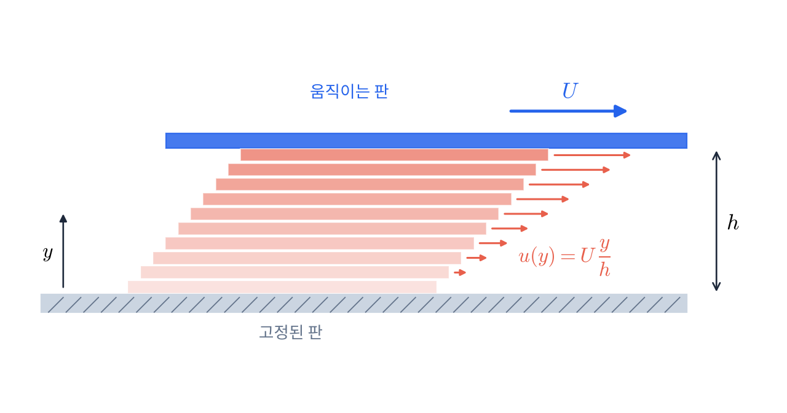
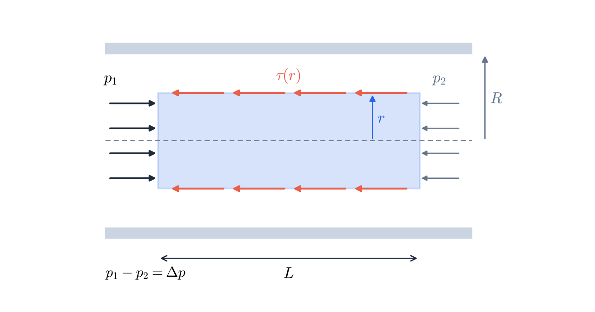
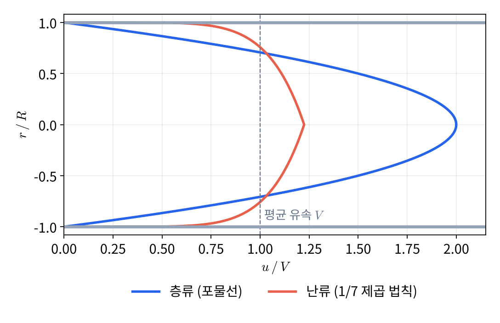
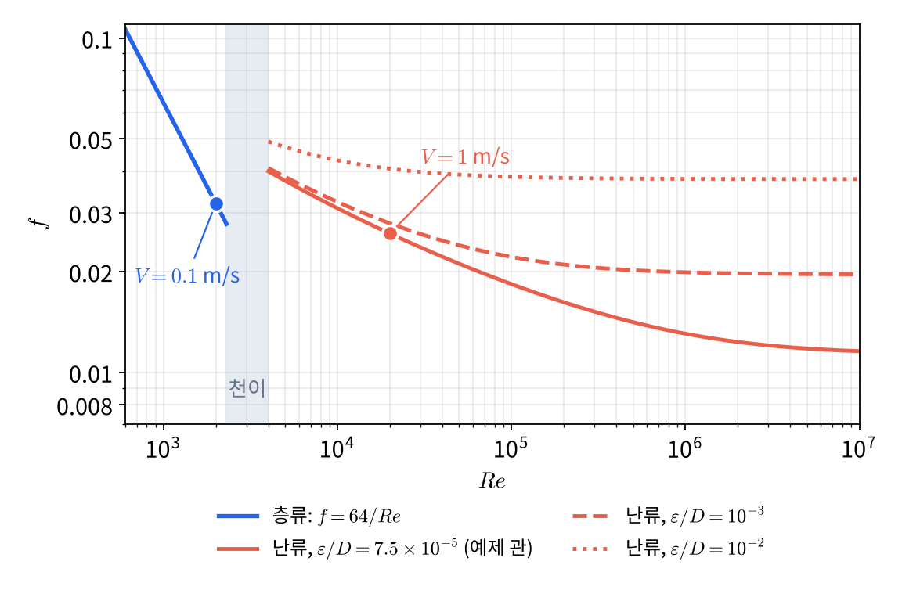

물이 관을 지나가면 압력이 떨어진다. 관이 길수록, 물이 빠를수록 더 많이 떨어진다.

이걸 식으로 쓴 것이 Darcy–Weisbach 식이다. 처음 보면 외워야 하는 공식처럼 생겼는데, 사실 식의 형태는 힘의 균형과 차원해석만으로 나온다. 실험에서 가져와야 하는 건 마찰계수 하나뿐이다.

이번 글에서는 뉴턴 점성 법칙에서 출발해 관 속 속도 분포를 유도하고, 마지막에 마찰 손실 식까지 가본다.

---

## 0. 한눈에 보기

$$
\begin{aligned}
&\text{뉴턴 점성 법칙:} && \tau = \mu \frac{du}{dy} \\
&\text{관 속 층류의 속도 분포:} && u(r) = \frac{\Delta p}{4\mu L}\left(R^2 - r^2\right) \\
&\text{마찰 손실 (Darcy–Weisbach):} && \Delta p = f\,\frac{L}{D}\,\frac{\rho V^2}{2}
\end{aligned}
$$

첫 번째 식은 실험에서 온 관계식이고, 나머지 두 개는 첫 번째 식과 힘의 균형으로 유도된다.

### 예제

다음과 같은 관이 있다고 해보자.

$$
D = 20\ \text{mm}, \qquad L = 10\ \text{m}, \qquad V = 1\ \text{m/s}
$$

$D$는 관의 내경, $L$은 관의 길이, $V$는 관 속 평균 유속이다. 흐르는 건 20 °C 물이다.

$$
\rho = 998\ \text{kg/m}^3, \qquad \mu = 1.0 \times 10^{-3}\ \text{Pa·s}
$$

$\rho$는 밀도, $\mu$는 점성계수다. 관은 안쪽이 매끈한 관(벽 거칠기 $\varepsilon = 0.0015\ \text{mm}$)으로 둔다.

---

## 1. 뉴턴 점성 법칙

간격이 $h$인 평판 두 장 사이에 유체를 채우고, 아래 판은 고정한 채 위 판만 $U$의 속도로 끈다고 해보자.

판에 닿은 유체는 판과 같이 움직인다(상대속도가 0이다). 아래 판에 닿은 유체는 멈춰 있고, 위 판에 닿은 유체는 $U$로 움직인다. 이를 점착 조건(no-slip condition)이라 한다. 그 사이의 속도는 0에서 $U$까지 직선으로 바뀐다.

_Fig.1 위 판만 움직이는 평판 사이 흐름(Couette 흐름). 유체를 얇은 층으로 나눠 보면 위층일수록 일정한 비율로 더 빨리 미끄러진다_

위 판을 계속 끌려면 힘이 든다. 실험해보면 판의 단위 면적당 필요한 힘은 속도 $U$에 비례하고 간격 $h$에 반비례한다.

$$
\frac{F}{A} = \mu\,\frac{U}{h}
$$

$U/h$는 높이에 따라 속도가 바뀌는 비율, 즉 속도 기울기다. 이를 일반적인 위치에서 쓰면 뉴턴 점성 법칙이 된다.

$$
\tau = \mu\,\frac{du}{dy}
$$

$\tau$는 전단응력이다. 유체 층끼리 미끄러질 때 서로 붙잡는 힘을 면적으로 나눈 값이다.

이 식이 말하는 바는 다음과 같다: 이웃한 층 사이의 속도 차가 클수록 서로 붙잡는 힘이 크다. 비례상수 $\mu$가 점성계수다.

이 식은 증명되는 식이 아니다. 뉴턴이 제안하고 실험으로 확인된 관계식이다. 질량 보존이나 운동량 보존처럼 근본 법칙에서 유도되는 게 아니라, 유체마다 성질을 정해주는 식(구성 방정식)이다.

그래서 순서를 거꾸로 보는 편이 정확하다. 이 관계를 잘 따르는 유체를 뉴턴 유체라 부른다. 물, 공기, 기름이 여기에 속하고, 케첩이나 혈액은 따르지 않는다. 점성계수 $\mu$도 이 식으로 정의하고 점도계로 잰다.

( 점착 조건도 마찬가지로 실험적 사실이다. 벽에 닿은 유체 분자는 벽과 함께 움직인다. )

---

## 2. 관 속 흐름: 속도는 왜 포물선인가

이제 평판 대신 둥근 관을 보자. 관 양 끝에 압력 차 $\Delta p$를 걸어 물을 민다.

다음을 가정한다.

관은 수평이고, 흐름은 시간에 따라 변하지 않는다. 또 관을 따라가도 속도 분포가 변하지 않는다(완전 발달 흐름). 마지막으로 흐름은 층류다. 층류가 언제 성립하는지는 2.4에서 따진다.

### 2.1 물기둥의 힘 균형

관 중심에서 반지름 $r$까지의 물기둥을 길이 $L$만큼 떼어 생각한다.

_Fig.2 반지름 r, 길이 L인 물기둥. 압력 차는 양 끝 단면에, 전단응력은 옆면에 걸린다_

이 물기둥에는 두 힘이 걸린다.

양 끝의 압력 차는 단면적 $\pi r^2$에 작용해 물기둥을 민다. 바깥 물이 붙잡는 전단응력 $\tau(r)$는 옆면적 $2\pi r L$에 작용해 물기둥을 잡아당긴다.

관을 따라 속도 분포가 변하지 않으니, 물기둥으로 들어오는 운동량과 나가는 운동량이 같다. 그래서 두 힘은 같아야 한다.

$$
\Delta p \cdot \pi r^2 = \tau(r) \cdot 2\pi r L
$$

정리하면 다음과 같다.

$$
\tau(r) = \frac{\Delta p}{2L}\,r
$$

전단응력은 관 중심에서 0이고, 벽으로 갈수록 직선으로 커진다.

$r$의 1차식이 나온 이유는 간단하다. 미는 힘은 단면적이라 $r^2$에 비례하고, 붙잡는 힘은 옆면적이라 $r$에 비례한다. 둘을 나누면 $r$이 남는다.

( 1장의 평판 흐름에는 압력 차가 없다. 그래서 전단응력이 어디서나 같고, 속도가 직선으로 나온다. )

### 2.2 속도 분포

뉴턴 점성 법칙을 쓴다. 관 속에서는 중심에서 벽으로 갈수록 속도가 줄어드니 부호를 붙인다.

$$
\tau = -\mu\,\frac{du}{dr}
$$

( $du/dr$가 음수라서, 전단응력의 크기를 양수로 두려고 $-$를 붙였다. )

2.1의 결과와 같다고 놓으면 다음과 같다.

$$
\frac{du}{dr} = -\frac{\Delta p}{2\mu L}\,r
$$

$r$로 적분한다.

$$
u(r) = -\frac{\Delta p}{4\mu L}\,r^2 + C
$$

적분상수 $C$는 점착 조건으로 정한다. 벽($r = R$)에 닿은 물은 멈춰 있으니 $u(R) = 0$이다.

$$
0 = -\frac{\Delta p}{4\mu L}\,R^2 + C \quad\Rightarrow\quad C = \frac{\Delta p R^2}{4\mu L}
$$

대입하면 관 속 속도 분포가 나온다.

$$
u(r) = \frac{\Delta p}{4\mu L}\left(R^2 - r^2\right)
$$

$r$의 2차식, 즉 포물선이다. 속도는 중심에서 가장 빠르다.

$$
u_{max} = u(0) = \frac{\Delta p R^2}{4\mu L}
$$

( 적분상수가 하나만 남은 이유: 중심에서 전단응력이 0이라는 조건은 2.1의 힘 균형에 이미 들어가 있다. )

### 2.3 유량과 평균 유속

유량은 단면 전체에서 속도를 더한 값이다. 반지름 $r$, 두께 $dr$인 고리의 면적이 $2\pi r\,dr$이니 다음과 같이 적분한다.

$$
\begin{aligned}
Q &= \int_0^R u(r)\,2\pi r\,dr \\
&= \frac{2\pi\,\Delta p}{4\mu L}\int_0^R \left(R^2 r - r^3\right) dr \\
&= \frac{2\pi\,\Delta p}{4\mu L}\left(\frac{R^4}{2} - \frac{R^4}{4}\right) \\
&= \frac{\pi R^4\,\Delta p}{8\mu L}
\end{aligned}
$$

이것이 Hagen–Poiseuille 식이다. 유량이 반지름의 4제곱에 비례한다.

평균 유속은 유량을 단면적으로 나눈 값이다.

$$
V = \frac{Q}{\pi R^2} = \frac{\Delta p R^2}{8\mu L} = \frac{u_{max}}{2}
$$

평균 유속은 중심 속도의 딱 절반이다.

마지막 식을 압력 차에 대해 정리해두자. $R = D/2$를 넣으면 다음과 같다.

$$
\Delta p = \frac{8\mu L V}{R^2} = \frac{32\,\mu L V}{D^2}
$$

층류에서는 압력 손실이 유속에 정비례한다. 이 식은 3장에서 다시 쓴다.

### 2.4 레이놀즈 수: 층류는 언제까지인가

지금까지는 층류를 가정했다. 층류인지 아닌지는 레이놀즈 수로 판단한다.

$$
Re = \frac{\rho V D}{\mu}
$$

흐름을 계속 밀고 가려는 관성력과 흐름을 붙잡는 점성력의 비다. 관 흐름에서는 대략 $Re < 2300$이면 층류, $Re > 4000$이면 난류다. 그 사이는 둘이 섞이는 천이 구간이다.

예제 관에 넣어보자.

$$
Re = \frac{998 \times 1 \times 0.02}{1.0\times10^{-3}} \approx 2.0 \times 10^4
$$

완전한 난류다. 이 관이 층류가 되려면 $Re < 2300$, 즉 유속이 약 0.115 m/s 이하여야 한다. 수도관처럼 일상적으로 물을 보내는 관은 거의 항상 난류라는 뜻이다.

층류 결과를 확인하려면 유속을 $V = 0.1\ \text{m/s}$로 낮춰야 한다. 이때 $Re \approx 2000$으로 층류이고, 2.3의 식으로 압력 손실을 바로 구할 수 있다.

$$
\Delta p = \frac{32 \times (1.0\times10^{-3}) \times 10 \times 0.1}{0.02^2} = 80\ \text{Pa}, \qquad u_{max} = 2V = 0.2\ \text{m/s}
$$

### 2.5 난류일 때의 속도 분포

난류에서는 물 입자가 소용돌이치며 섞인다. 그래서 2.2처럼 깔끔하게 적분되지 않는다.

대신 실험에서 얻은 근사식(1/7 제곱 법칙)을 쓴다.

$$
\frac{u}{u_{max}} = \left(1 - \frac{r}{R}\right)^{1/7}
$$

_Fig.3 평균 유속이 같을 때의 속도 분포. 층류는 포물선이고, 난류는 가운데가 납작하고 벽 근처에서 급하게 떨어진다_

섞임 때문에 가운데 속도가 고르게 퍼져서 분포가 납작해진다. 대신 벽 근처에서 속도가 급하게 떨어진다.

벽에서 속도 기울기가 크면 뉴턴 점성 법칙에 따라 벽 전단응력이 크다. 그래서 같은 평균 유속이라도 난류가 층류보다 마찰이 훨씬 크다.

---

## 3. 마찰 손실: Darcy–Weisbach 식

### 3.1 관 전체의 힘 균형

2.1의 물기둥을 관 벽까지 넓힌다. $r = R = D/2$를 넣고, 벽에서의 전단응력을 $\tau_w$라 하자.

$$
\Delta p \cdot \frac{\pi D^2}{4} = \tau_w \cdot \pi D L
\quad\Rightarrow\quad
\Delta p = \frac{4\,\tau_w L}{D}
$$

이 식은 층류든 난류든 성립한다. 힘의 균형만 썼기 때문이다. 층류에서만 성립하는 부분은 2.2에서 뉴턴 점성 법칙으로 속도를 구한 단계다.

( 층류라면 2.1의 결과에 $r = R$을 넣어 $\tau_w = \Delta p R / 2L$이고, 위 식과 똑같다. )

문제는 난류에서 $\tau_w$를 이론으로 구할 수 없다는 점이다.

### 3.2 마찰계수 정의

모르는 $\tau_w$를 동압 $\rho V^2/2$와 비교한 무차원 수로 바꿔 쓴다. 동압은 흐름이 가진 운동에너지를 부피당으로 나타낸 값이다.

$$
f \equiv \frac{8\,\tau_w}{\rho V^2}
$$

이를 3.1의 식에 넣으면 Darcy–Weisbach 식이 나온다.

$$
\Delta p = \frac{4L}{D}\cdot\frac{f \rho V^2}{8} = f\,\frac{L}{D}\,\frac{\rho V^2}{2}
$$

이 식이 말하는 바는 다음과 같다: 관이 지름에 비해 길수록($L/D$), 흐름이 빠를수록($V^2$) 압력을 많이 잃는다.

( 정의에 붙은 8은 식 모양을 이렇게 맞추려고 고른 숫자다. 교재에 따라 $\tau_w$를 그냥 동압으로 나눈 Fanning 마찰계수를 쓰기도 하는데, Darcy 마찰계수의 1/4이다. )

여기까지는 정의를 바꿔 쓴 것뿐이다. 남은 질문은 $f$가 무엇으로 정해지느냐다.

### 3.3 차원해석: $f$는 무엇으로 정해지는가

벽 전단응력 $\tau_w$는 물의 밀도와 점성, 유속, 관의 지름과 벽의 거칠기로 정해진다고 볼 수 있다.

$$
\tau_w = F(\rho,\ V,\ D,\ \mu,\ \varepsilon)
$$

변수는 $\tau_w$까지 6개이고, 기본 차원은 질량 $\mathsf{M}$, 길이 $\mathsf{L}$, 시간 $\mathsf{T}$ 3개다. 버킹엄 π 정리에 따르면 이 관계는 무차원 묶음 $6 - 3 = 3$개 사이의 관계로 줄어든다.

각 변수의 차원은 다음과 같다.

$$
[\tau_w] = \mathsf{M\,L^{-1}\,T^{-2}}, \quad [\rho] = \mathsf{M\,L^{-3}}, \quad [V] = \mathsf{L\,T^{-1}}, \quad [D] = \mathsf{L}, \quad [\mu] = \mathsf{M\,L^{-1}\,T^{-1}}, \quad [\varepsilon] = \mathsf{L}
$$

$\rho, V, D$를 기준으로 삼고 나머지를 무차원으로 만든다. 예를 들어 $\mu$는 $\mu\,\rho^a V^b D^c$의 차원이 0이 되도록 지수를 고른다.

$$
\begin{aligned}
\mathsf{M}&: \quad 1 + a = 0 \\
\mathsf{T}&: \quad -1 - b = 0 \\
\mathsf{L}&: \quad -1 - 3a + b + c = 0
\end{aligned}
\quad\Rightarrow\quad a = b = c = -1
$$

즉 $\mu / (\rho V D) = 1/Re$다. 같은 방법으로 $\tau_w$는 $\tau_w/(\rho V^2)$, $\varepsilon$은 $\varepsilon/D$가 된다.

따라서 다음과 같이 쓸 수 있다.

$$
\frac{\tau_w}{\rho V^2} = \phi\!\left(Re,\ \frac{\varepsilon}{D}\right)
\quad\Rightarrow\quad
f = 8\,\phi\!\left(Re,\ \frac{\varepsilon}{D}\right)
$$

마찰계수는 레이놀즈 수와 상대 거칠기 $\varepsilon/D$, 이 두 무차원 수만의 함수다. 식의 형태는 여기까지 유도된다. 실험으로 정해야 하는 건 함수 $\phi$의 구체적인 모양뿐이다.

### 3.4 층류: $f = 64/Re$

층류에서는 그 모양까지 이론으로 나온다. 2.3에서 구한 층류의 압력 손실과 Darcy–Weisbach 식을 같다고 놓는다.

$$
\frac{32\,\mu L V}{D^2} = f\,\frac{L}{D}\,\frac{\rho V^2}{2}
$$

$f$에 대해 정리한다.

$$
f = \frac{64\,\mu}{\rho V D} = \frac{64}{Re}
$$

층류의 마찰계수는 벽 거칠기와 상관없이 레이놀즈 수만으로 정해진다. 2.4의 층류 예($Re \approx 2000$)를 넣으면 $f = 0.032$이고, Darcy–Weisbach 식으로 계산해도 80 Pa이 그대로 나온다.

### 3.5 난류: 실험에서 온 마찰계수

난류에서는 $\phi$를 실험으로 정한다. Nikuradse가 관 벽에 모래를 붙여 거칠기를 바꿔가며 측정했고, Colebrook이 실제 관의 측정값까지 맞추는 식을 만들었다. 이 식을 그래프로 그린 것이 Moody 선도다.

$$
\frac{1}{\sqrt f} = -2\log_{10}\!\left(\frac{\varepsilon}{3.7D} + \frac{2.51}{Re\sqrt f}\right)
$$

양변에 $f$가 있어서 반복 계산으로 풀어야 한다. 손으로 계산할 때는 바로 값이 나오는 Swamee–Jain 근사식을 많이 쓴다.

$$
f = \frac{0.25}{\left[\log_{10}\!\left(\dfrac{\varepsilon}{3.7D} + \dfrac{5.74}{Re^{0.9}}\right)\right]^2}
$$

_Fig.4 레이놀즈 수에 따른 마찰계수. 층류 구간은 64/Re, 난류 구간은 Colebrook 식. 점은 2.4와 3.5의 두 예제다_

예제 관에 넣어보자. $Re \approx 2.0\times10^4$, $\varepsilon/D = 0.0015/20 = 7.5\times10^{-5}$이다.

$$
f \approx 0.026
$$

Darcy–Weisbach 식으로 압력 손실을 구한다. $L/D = 500$, 동압은 $\rho V^2/2 = 499\ \text{Pa}$이다.

$$
\Delta p = 0.026 \times 500 \times 499\ \text{Pa} \approx 6.5\ \text{kPa}
$$

( 물기둥 약 0.66 m를 들어 올리는 압력이다. 10 m짜리 관 하나 지나는 데 이만큼 잃는다. )

같은 $Re$에 층류 식 $64/Re$를 넣으면 0.0032가 나온다. 난류의 마찰계수가 8배쯤 크다. 2.5에서 본 대로 벽 근처 속도 기울기가 가파르기 때문이다.

---

## 4. 지름의 5제곱

같은 유량을 보낼 때 관 굵기가 얼마나 중요한지 보자. 평균 유속은 유량을 단면적으로 나눈 값이다.

$$
V = \frac{4Q}{\pi D^2}
$$

이를 Darcy–Weisbach 식에 넣는다.

$$
\Delta p = f\,\frac{L}{D}\,\frac{\rho}{2}\left(\frac{4Q}{\pi D^2}\right)^2 = \frac{8 f \rho L\, Q^2}{\pi^2 D^5}
$$

유량이 같으면 압력 손실은 지름의 5제곱에 반비례한다.

예제의 유량($Q \approx 18.8\ \text{L/min}$)을 그대로 두고 관 굵기만 바꿔 계산하면 다음과 같다. 길이는 10 m 그대로다.

| 내경 | 평균 유속 | $f$ | 압력 손실 |
|---|---|---|---|
| 15 mm | 1.78 m/s | 0.024 | 25.6 kPa |
| 20 mm | 1.00 m/s | 0.026 | 6.5 kPa |
| 25 mm | 0.64 m/s | 0.027 | 2.2 kPa |
| 30 mm | 0.44 m/s | 0.029 | 0.95 kPa |

20 mm에서 25 mm로 지름을 25%만 늘려도 손실은 1/3 정도로 줄어든다.

( 정확히는 $f$도 지름에 따라 조금씩 바뀐다. 매끈한 관의 난류에서는 지름이 커질수록 $f$가 살짝 커져서, 실제 손실은 5제곱보다 조금 덜 줄어든다. 표에서 15 mm가 정확히 $(20/15)^5 \approx 4.2$배가 아니라 3.9배인 이유다. )

곧은 관 말고도 배관에는 이음새, 굽은 곳, 밸브가 있다. 이런 곳에서 생기는 손실(부차 손실)은 동압에 계수 $K$를 곱해 따로 더한다.

$$
\Delta p_{minor} = K\,\frac{\rho V^2}{2}
$$

$K$는 부품 모양마다 실험으로 정해진 값을 쓴다.

---

## 5. 정리

뉴턴 점성 법칙은 실험에서 온 식이다. 유체 층 사이의 전단응력이 속도 기울기에 비례한다는 관계이고, 점성계수 $\mu$도 이 식으로 정의한다.

관 속 층류의 속도 분포는 힘의 균형과 뉴턴 점성 법칙, 점착 조건만으로 유도된다. 결과는 포물선이고, 평균 유속은 중심 속도의 절반이다.

Darcy–Weisbach 식의 형태도 유도된다. 관 전체의 힘 균형에서 $\Delta p = 4\tau_w L/D$가 나오고, 차원해석으로 마찰계수가 $Re$와 $\varepsilon/D$만의 함수라는 것까지 나온다.

실험에서 가져와야 하는 건 난류의 마찰계수 하나다. 층류는 그마저도 $64/Re$로 이론에서 나온다.

설계에서 기억할 것은 $\Delta p \propto L Q^2 / D^5$ 하나다. 같은 유량을 보낼 거라면 관을 조금만 굵혀도 손실이 크게 준다.
